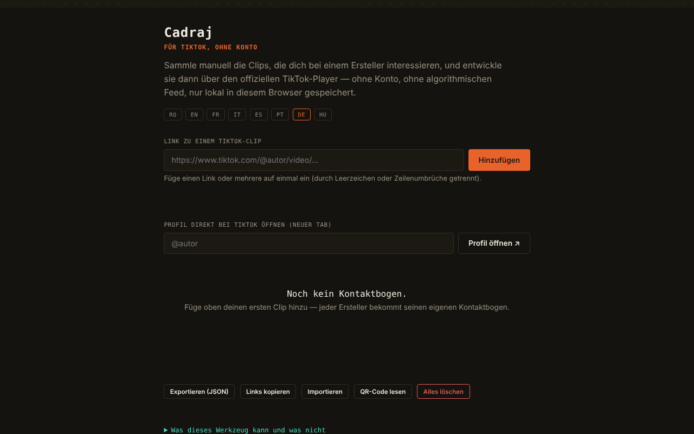

# Cadraj

[English](README.md) · [Română](README.ro.md) · [Français](README.fr.md) · [Italiano](README.it.md) · [Español](README.es.md) · [Português](README.pt.md) · **Deutsch** · [Magyar](README.hu.md)

**Version:** 1.2.5 · **Zuletzt aktualisiert:** 2026-10-23

Oberflächensprachen: **Română, English, Français, Italiano, Español, Português (PT), Deutsch, Magyar**

Cadraj — für TikTok, ohne Konto: ein persönlicher „Kontaktbogen“ für manuell hinzugefügte TikTok-Clips.

**Online-App:** https://chiuta.github.io/Cadraj/

## Was es ist

Cadraj ist eine App in einer einzigen HTML-Datei, in der du manuell Links zu TikTok-Clips eines Autors hinzufügst; die App gruppiert sie in Sammlungen (eine pro Autor) und zeigt sie über den offiziellen Einbettungs-Player von TikTok an, ohne Konto und ohne algorithmischen Feed. Die App sagt ausdrücklich, was sie nicht tut: Sie listet die Clips eines Profils nicht automatisch auf, umgeht keine TikTok-Schutzmaßnahmen und lädt keine Videodateien herunter.

## Funktionen

- Hinzufügen eines Clips per Link (`https://www.tiktok.com/@autor/video/...`), mit Statusmeldung; du kannst mehrere Links auf einmal einfügen (getrennt durch Leerzeichen, Komma oder Zeilenumbruch) — die Zusammenfassung sagt, wie viele hinzugefügt wurden, wie viele schon in der Sammlung waren und wie viele ignoriert wurden.
- „Links kopieren“: alle Links der Sammlung, einer pro Zeile, in die Zwischenablage.
- Druckstil: Es wird nur die Liste der Sammlungen gedruckt.
- Sammlungen pro Autor, mit einer Textnotiz zu jedem Clip.
- Öffnen eines TikTok-Profils in einem neuen Tab (Feld „@autor“, Schaltfläche „Profil öffnen ↗“); offline erscheint statt der Fehlerseite des Browsers eine erklärende Meldung.
- Suche in den Sammlungen (nach Autor oder Wörtern in den Notizen) und der Filter „Nur ungesehene Bilder“.
- Markierung „gesehen“ an jedem Bild (Schaltfläche ○/✓; wird automatisch gesetzt, wenn du das Bild im Player öffnest), mit einem Zähler „N gesehen“ auf dem Bogen; sie bleibt in der Sammlung und im JSON-Export erhalten.
- Vergrößerte Ansicht (Lightbox) mit Navigation ‹ / ›, den Tasten Pfeil links / Pfeil rechts und Escape zum Schließen.
- Export und Import der Sammlung als JSON-Datei; „Alles löschen“.
- Oberfläche in 8 Sprachen: RO, EN, FR, IT, ES, PT, DE, HU.

## Neue Funktionen (v1.1.0)

- **QR-Code für eine Sammlung**: Er enthält nur den Benutzernamen und die IDs der Bilder (die mit `p` markierten Fotos), nicht die Notizen und keine anderen Sammlungen. Höchstens 40 Clips in einem Code, mit der Meldung „40 von N“. Das Lesen aus einem QR-Bild erstellt die Sammlung neu; ein zweites Lesen dupliziert nichts, ein fremder QR und ungültige Benutzernamen (z. B. `__proto__`) werden abgelehnt, ungültige IDs ignoriert.
- **Barrierefreiheitsmodus**: größerer Text (+25 %), hoher Kontrast, keine Animationen; die Einstellungen bleiben erhalten und sind in der `.fff.json`-Kopie enthalten.
- **Player mit gefangenem Fokus**: Beim Öffnen wird der Hintergrund inaktiv (`inert`), Tab/Umschalt+Tab verlassen den Player nicht, Pos1/Ende/Pfeile navigieren, Esc schließt und der Fokus kehrt zu dem Bild zurück, von dem aus geöffnet wurde.
- **Kit**: Transparenz und `.fff.json`-Kopie (die Sammlungen), `core, label, bundle, qr`.
- **Sprachen und Übersetzungen**: Die neuen Texte liegen in den 8 Sprachen der App vor (RO, EN, FR, IT, ES, PT, DE, HU). Die Übersetzungen FR/IT/ES/PT/DE/HU sind automatisch und **nicht von Muttersprachlern geprüft**; der Dialog des Kits hat 8 Sprachen.

## Anleitung

1. Wähle die Sprache über die Schaltflächen RO / EN / FR / IT / ES / PT / DE / HU.
2. Wenn du Clips finden willst, schreibe „@autor“ in das Profilfeld und drücke „Profil öffnen ↗“; das Profil öffnet sich auf TikTok in einem separaten Tab.
3. Kopiere den Link eines Clips, füge ihn in das Feld „Link zu einem TikTok-Clip“ ein und drücke „Hinzufügen“.
4. Der Clip erscheint in der Sammlung des Autors; du kannst darunter eine Notiz schreiben (Enter bestätigt).
5. Klicke auf einen Clip, um ihn im Player zu öffnen; du navigierst mit ‹ › oder mit den Pfeiltasten und schließt mit ✕ oder Escape.
6. Verwende „In Sammlungen suchen“ zum Filtern.
7. „Exportieren (JSON)“ speichert die Sammlung in einer Datei; „Importieren“ lädt sie wieder; „Alles löschen“ leert die Sammlung.

## Datenschutz und Netzwerk

- Das Kit „ohne Grenzen“ (`fff-kit`, Module `core, label, bundle, qr`) ist in `index.html` eingebettet: Es stellt keine Netzwerkanfragen. Der Dialog „Transparenz“ (Klick auf die Version) zeigt das deklarierte Netzwerk (0 externe Anfragen), die `localStorage`-Schlüssel, den SHA-256 der Datei und bietet eine `.fff.json`-Sicherungskopie an (optional mit Passwort verschlüsselt, AES-GCM). QR-Codes werden lokal erzeugt und gelesen; das Lesen erfolgt nur aus einem vom Benutzer gewählten Bild, ohne Kamera.

- Lokal: Die Sammlung (Links und Notizen) wird im `localStorage` des Browsers unter dem Schlüssel `tiktok-fara-cont:v1` gespeichert. Es gibt kein Konto und keinen eigenen Server der App; im geprüften Code gibt es keine `fetch`-Aufrufe.
- Netzwerk: Die App ist nicht vollständig offline (ohne Netzwerk zeigt die Ansicht eine erklärende Meldung). Beim Anzeigen eines Clips wird in einem iframe mit `sandbox` der offizielle Player `https://www.tiktok.com/player/v1/<id>` geladen, sodass TikTok die Anfrage erhält (und eigene Cookies/Richtlinien anwenden kann). Die Profilschaltfläche und die Links zu Clips öffnen `www.tiktok.com`. Im Code gibt es keine weiteren Drittanbieter-Hosts.
- Die Fußzeile der App sagt jetzt ausdrücklich: „ohne Konto · ohne Telemetrie · ohne eigenen Server · das Abspielen eines Clips lädt den TikTok-Player“ (die Aussage „ohne Telemetrie“ betrifft die App selbst, nicht den TikTok-Player im iframe).
- Marken: TikTok ist eine Marke ihres Inhabers und wird beschreibend verwendet (die App ist nicht mit TikTok verbunden).

## Lokal / offline ausführen

Lade `index.html` herunter und öffne sie in einem Browser. Sammlung und Oberfläche funktionieren lokal; das Abspielen von Clips und das Öffnen von Profilen erfordern Internet.

## Lizenz

MIT für den Code und die Struktur der App — siehe Datei `LICENSE`. Gegebenenfalls in der Datei enthaltene Bibliotheken Dritter behalten ihre eigenen Lizenzen.

## Verlauf / Changelog

- 1.2.4 — 2026-10-22: fff-kit 1.1.4: Touch-Ziele und Mindestschriftgröße
- 1.2.3 — 2026-10-22: fff-kit 1.1.2: PBKDF2 mit 600.000 Iterationen, Schutz vor Clickjacking
- 1.2.1 — 2026-10-22: **Korrektur**: ungarische Oberfläche vervollständigt (QR-Code-Texte und Bedienungshilfen, einschließlich des Hinweises zu den Player-Tasten).
- 1.1.0 — 2026-10-14: QR-Code für Sammlungen, Barrierefreiheitsmodus, Player mit gefangenem Fokus, Kit „ohne Grenzen“. Tests: `tests/fff-r8.test.mjs`.

### 1.2.2 — 2026-10-22
- Die blockierenden alert()/confirm()-Dialoge wurden ersetzt: Importfehler erscheinen in der Statuszeile der Seite, und Lösch-Bestätigungen nutzen einen barrierefreien, übersetzten Dialog.
- Größere Touch-Ziele (Sprachumschalter und kleine Schaltflächen mindestens 32–36 px).
- Mobil: kein Text unter 12 px und Touch-Ziele von mindestens 24 px (WCAG 2.5.8).

### 1.0.0 — 2026-10-12
- Version und Datum der letzten Aktualisierung werden in der App angezeigt (Fußzeile, in 7 Sprachen).

### 11. Oktober 2026 (Runde 7)
- Behoben: Das Öffnen eines Profils offline zeigt jetzt eine Meldung in der App (7 Sprachen), nicht die Fehlerseite des Browsers.
- Neu: Markierung „gesehen“ pro Bild, Zähler auf dem Bogen und der Filter „Nur ungesehene Bilder“ (neuer Schlüssel `seen` in der gespeicherten/exportierten Sammlung).

### 11. Oktober 2026 (Runde 6)
- Hinzugefügt: Massenhinzufügen von Links, die Schaltfläche „Links kopieren“, Druckstil, neue Meldungen in 7 Sprachen.
- Sicherheit: CSP mit `script-src` per Hash (ohne `'unsafe-inline'` für Skripte).

### 11. Oktober 2026
- Hinzugefügt: Attribut `sandbox` am iframe des TikTok-Players und CSP-Richtlinie (frame-src nur `www.tiktok.com`, kein connect-src).
- Hinzugefügt: klare Meldung in der Ansicht, wenn der Browser offline ist (statt eines leeren Rahmens), in allen 7 Sprachen.
- Behoben: Der Seiteninhalt ist jetzt in `<main>` eingefasst (0 axe-core-Verstöße bei 1280 und 360 px).

## Autor

Alexio — Alexandru-Ionuț Chiuță, Kontakt: alexio@trom.tf

## Zusammenfassung

Cadraj ist ein Einzeldatei-HTML-Werkzeug zum Aufbau eines persönlichen Kontaktbogens aus TikTok-Clips, die manuell per Link hinzugefügt, nach Autor gruppiert und über den offiziellen Einbettungs-Player von TikTok abgespielt werden, mit Notizen, Suche, Lightbox, Massen-Einfügen von Links, Kopieren aller Links und JSON-Export/-Import. Die Daten bleiben im localStorage; die Wiedergabe lädt tiktok.com in einem iframe und braucht daher Internet. Oberfläche in 8 Sprachen. Es liest keine Profile aus und lädt keine Videos herunter.

## Audit

Audit: 2026-10-10 — geprüft: 0 JS-Fehler, 0 schwerwiegende/kritische axe-Probleme; der einzige externe Verkehr ist der iframe des offiziellen Players `tiktok.com/player/v1/<id>` (die ID durchläuft eine Validierung `\d{5,25}`, der JSON-Import wird bereinigt, Texte werden mit `textContent` eingefügt). Die Fußzeile „ohne Konto · ohne Telemetrie · ohne Server“ bezieht sich auf die App; beim Abspielen eines TikTok-Clips erhält TikTok die IP-Adresse und die Clip-ID (die App sagt das im Panel „Info“). Die App ist nicht mit TikTok verbunden; die Einhaltung der TikTok-Bedingungen für Einbettungen bleibt Sache des Benutzers.
