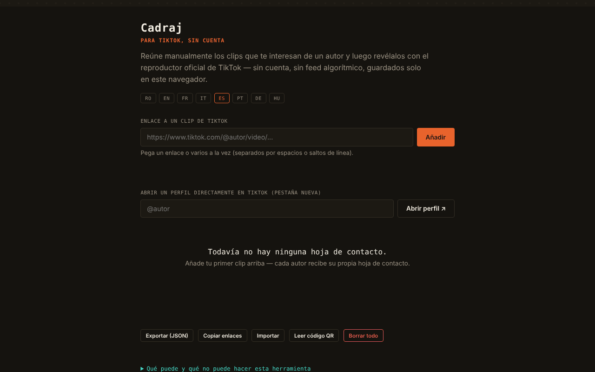

# Cadraj

[English](README.md) · [Română](README.ro.md) · [Français](README.fr.md) · [Italiano](README.it.md) · **Español** · [Português](README.pt.md) · [Deutsch](README.de.md) · [Magyar](README.hu.md)

**Versión:** 1.2.3 · **Última actualización:** 2026-10-22

Idiomas de la interfaz: **Română, English, Français, Italiano, Español, Português (PT), Deutsch, Magyar**

Cadraj — para TikTok, sin cuenta: una «hoja de contactos» personal para clips de TikTok añadidos manualmente.

**Aplicación en línea:** https://chiuta.github.io/Cadraj/

## Qué es

Cadraj es una aplicación en un único archivo HTML en la que añades manualmente enlaces a clips de TikTok de un autor; la aplicación los agrupa en colecciones (una por autor) y los muestra mediante el reproductor de incrustación oficial de TikTok, sin cuenta y sin feed algorítmico. La aplicación dice explícitamente lo que no hace: no enumera automáticamente los clips de un perfil, no elude las protecciones de TikTok y no descarga archivos de vídeo.

## Funciones

- Añadir un clip mediante enlace (`https://www.tiktok.com/@autor/video/...`), con mensaje de estado; puedes pegar varios enlaces a la vez (separados por espacio, coma o salto de línea) — el resumen indica cuántos se añadieron, cuántos ya estaban en la colección y cuántos se ignoraron.
- «Copiar los enlaces»: todos los enlaces de la colección, uno por línea, al portapapeles.
- Estilo de impresión: solo se imprime la lista de colecciones.
- Colecciones por autor, con una nota de texto para cada clip.
- Apertura de un perfil de TikTok en una pestaña nueva (campo «@autor», botón «Abrir el perfil ↗»); sin conexión aparece un mensaje explicativo en lugar de la página de error del navegador.
- Búsqueda en las colecciones (por autor o por palabras de las notas) y filtro «Solo los fotogramas no vistos».
- Marca «visto» en cada fotograma (botón ○/✓; se marca automáticamente al abrir el fotograma en el reproductor), con un contador «N vistos» en la hoja; se conserva en la colección y en la exportación JSON.
- Vista ampliada (lightbox) con navegación ‹ / ›, teclas Flecha izquierda / Flecha derecha y Escape para cerrar.
- Exportación e importación de la colección como archivo JSON; «Borrar todo».
- Interfaz en 8 idiomas: RO, EN, FR, IT, ES, PT, DE, HU.

## Funciones nuevas (v1.1.0)

- **Código QR para una colección**: contiene solo el nombre de usuario y los ids de los fotogramas (las fotos marcadas con `p`), no las notas ni otras colecciones. Un máximo de 40 clips en un código, con el mensaje «40 de N». La lectura desde una imagen QR recrea la colección; una segunda lectura no duplica, un QR ajeno y los nombres de usuario no válidos (p. ej. `__proto__`) se rechazan, los ids no válidos se ignoran.
- **Modo de accesibilidad**: texto más grande (+25 %), alto contraste, sin animaciones; las preferencias se conservan y entran en la copia `.fff.json`.
- **Reproductor con foco atrapado**: al abrirse, el fondo queda inactivo (`inert`), Tab/Mayús+Tab no salen del reproductor, Inicio/Fin/flechas navegan, Esc cierra y el foco vuelve al fotograma desde el que se abrió.
- **Kit**: Transparencia y copia `.fff.json` (las colecciones), `core, label, bundle, qr`.
- **Idiomas y traducciones**: los textos nuevos están en los 8 idiomas de la aplicación (RO, EN, FR, IT, ES, PT, DE, HU). Las traducciones FR/IT/ES/PT/DE/HU son automáticas y **no están verificadas por hablantes nativos**; el cuadro de diálogo del kit tiene 8 idiomas.

## Manual de uso

1. Elige el idioma con los botones RO / EN / FR / IT / ES / PT / DE / HU.
2. Si quieres encontrar clips, escribe «@autor» en el campo de perfil y pulsa «Abrir el perfil ↗»; el perfil se abre en TikTok, en una pestaña aparte.
3. Copia el enlace de un clip, pégalo en el campo «Enlace a un clip de TikTok» y pulsa «Añadir».
4. El clip aparece en la colección del autor; puedes escribir una nota debajo (Enter confirma).
5. Pulsa sobre un clip para abrirlo en el reproductor; navegas con ‹ › o con las flechas del teclado y cierras con ✕ o Escape.
6. Usa «Buscar en las colecciones» para filtrar.
7. «Exportar (JSON)» guarda la colección en un archivo; «Importar» la vuelve a cargar; «Borrar todo» vacía la colección.

## Privacidad y red

- El kit «sin fronteras» (`fff-kit`, módulos `core, label, bundle, qr`) está pegado en `index.html`: no realiza solicitudes de red. El cuadro «Transparencia» (clic en la versión) muestra la red declarada (0 solicitudes externas), las claves de `localStorage`, el SHA-256 del archivo y ofrece una copia de seguridad `.fff.json` (opcionalmente cifrada con contraseña, AES-GCM). Los códigos QR se generan y se leen en local; la lectura se hace solo desde una imagen elegida por el usuario, sin cámara.

- Local: la colección (enlaces y notas) se conserva en el `localStorage` del navegador, bajo la clave `tiktok-fara-cont:v1`. No hay cuenta ni servidor propio de la aplicación; en el código verificado no hay llamadas `fetch`.
- Red: la aplicación no es completamente offline (sin red, la vista muestra un mensaje explicativo). Al ver un clip se carga, en un iframe con `sandbox`, el reproductor oficial `https://www.tiktok.com/player/v1/<id>`, por lo que TikTok recibe la solicitud (y puede aplicar sus propias cookies/políticas). El botón de perfil y los enlaces a clips abren `www.tiktok.com`. No hay otros hosts de terceros en el código.
- El pie de la aplicación dice ahora explícitamente: «sin cuenta · sin telemetría · sin servidor propio · la reproducción de un clip carga el reproductor de TikTok» (la afirmación «sin telemetría» se refiere a la aplicación en sí, no al reproductor de TikTok en el iframe).
- Marcas: TikTok es una marca de su titular, usada de forma descriptiva (la aplicación no está afiliada a TikTok).

## Ejecución local / sin conexión

Descarga `index.html` y ábrelo en un navegador. La colección y la interfaz funcionan en local; la reproducción de clips y la apertura de perfiles requieren internet.

## Licencia

MIT para el código y la estructura de la aplicación — véase el archivo `LICENSE`. Las eventuales bibliotecas de terceros incluidas en el archivo conservan sus propias licencias.

## Historial / Changelog

- 1.2.3 — 2026-10-22: fff-kit 1.1.2: PBKDF2 600 000 iteraciones, protección anti-clickjacking
- 1.2.1 — 2026-10-22: **corrección**: interfaz en húngaro completada (cadenas del código QR y panel de accesibilidad, incluida la pista de las teclas del reproductor).
- 1.1.0 — 2026-10-14: código QR para colecciones, modo de accesibilidad, reproductor con foco atrapado, kit «sin fronteras». Pruebas: `tests/fff-r8.test.mjs`.

### 1.2.2 — 2026-10-22
- Se sustituyeron los cuadros bloqueantes alert()/confirm(): los errores de importación aparecen en la línea de estado de la página y las confirmaciones de borrado usan un diálogo accesible y traducido.
- Áreas táctiles más grandes (selector de idioma y botones pequeños de al menos 32–36 px).
- Móvil: ningún texto por debajo de 12 px y áreas táctiles de al menos 24 px (WCAG 2.5.8).

### 1.0.0 — 2026-10-12
- La versión y la fecha de la última actualización se muestran en la aplicación (pie, en 7 idiomas).

### 11 de octubre de 2026 (ronda 7)
- Corregido: abrir un perfil sin conexión muestra ahora un mensaje en la aplicación (7 idiomas), no la página de error del navegador.
- Novedad: marca «visto» por fotograma, contador en la hoja y filtro «Solo los fotogramas no vistos» (nueva clave `seen` en la colección guardada/exportada).

### 11 de octubre de 2026 (ronda 6)
- Añadido: adición masiva de enlaces, botón «Copiar los enlaces», estilo de impresión, mensajes nuevos en 7 idiomas.
- Seguridad: CSP con `script-src` mediante hash (sin `'unsafe-inline'` para scripts).

### 11 de octubre de 2026
- Añadido: atributo `sandbox` en el iframe del reproductor de TikTok y política CSP (frame-src solo `www.tiktok.com`, sin connect-src).
- Añadido: mensaje claro en la vista cuando el navegador está sin conexión (en lugar de un marco vacío), en los 7 idiomas.
- Corregido: el contenido de la página está ahora envuelto en `<main>` (0 infracciones de axe-core a 1280 y 360 px).

## Autor

Alexio — Alexandru-Ionuț Chiuță, contacto: alexio@trom.tf

## Resumen

Cadraj es una herramienta HTML de un solo archivo para construir una hoja de contactos personal de clips de TikTok añadidos manualmente mediante enlace, agrupados por autor, reproducidos mediante el reproductor de incrustación oficial de TikTok, con notas, búsqueda, lightbox, pegado masivo de enlaces, copia de todos los enlaces y exportación/importación JSON. Los datos permanecen en localStorage; la reproducción carga tiktok.com en un iframe, por lo que necesita internet. Interfaz en 8 idiomas. No extrae datos de los perfiles ni descarga vídeos.

## Auditoría

Auditoría: 2026-10-10 — verificado: 0 errores JS, 0 problemas axe graves/críticos; el único tráfico externo es el iframe del reproductor oficial `tiktok.com/player/v1/<id>` (el ID pasa por una validación `\d{5,25}`, la importación JSON está saneada, los textos se insertan con `textContent`). El pie «sin cuenta · sin telemetría · sin servidor» se refiere a la aplicación; al reproducir un clip de TikTok, TikTok recibe la dirección IP y el ID del clip (la aplicación lo dice en el panel «Info»). La aplicación no está afiliada a TikTok; el cumplimiento de los términos de TikTok para las incrustaciones sigue siendo responsabilidad del usuario.
