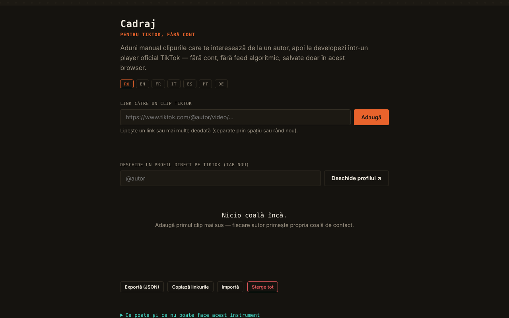

# Cadraj

[English](README.md) · [Română](README.ro.md) · **Français** · [Italiano](README.it.md) · [Español](README.es.md) · [Português](README.pt.md) · [Deutsch](README.de.md) · [Magyar](README.hu.md)

**Version :** 1.2.0 · **Dernière mise à jour :** 2026-10-19

Langues de l'interface : **Română, English, Français, Italiano, Español, Português (PT), Deutsch, Magyar**

Cadraj — pour TikTok, sans compte : une « planche-contact » personnelle pour des clips TikTok ajoutés manuellement.

**Application en ligne :** https://chiuta.github.io/Cadraj/

## Ce que c'est

Cadraj est une application en un seul fichier HTML dans laquelle vous ajoutez manuellement des liens vers des clips TikTok d'un auteur ; l'application les regroupe en collections (une par auteur) et les affiche via le lecteur d'intégration officiel de TikTok, sans compte et sans fil algorithmique. L'application dit explicitement ce qu'elle ne fait pas : elle ne liste pas automatiquement les clips d'un profil, ne contourne pas les protections de TikTok et ne télécharge pas de fichiers vidéo.

## Fonctions

- Ajout d'un clip par lien (`https://www.tiktok.com/@auteur/video/...`), avec un message d'état ; vous pouvez coller plusieurs liens à la fois (séparés par un espace, une virgule ou un retour à la ligne) — le récapitulatif indique combien ont été ajoutés, combien figuraient déjà dans la collection et combien ont été ignorés.
- « Copier les liens » : tous les liens de la collection, un par ligne, dans le presse-papiers.
- Style d'impression : seule la liste des collections est imprimée.
- Collections par auteur, avec une note textuelle pour chaque clip.
- Ouverture d'un profil TikTok dans un nouvel onglet (champ « @auteur », bouton « Ouvrir le profil ↗ ») ; hors ligne, un message explicatif apparaît à la place de la page d'erreur du navigateur.
- Recherche dans les collections (par auteur ou par mots des notes) et filtre « Seulement les cadres non vus ».
- Marque « vu » sur chaque cadre (bouton ○/✓ ; cochée automatiquement quand vous ouvrez le cadre dans le lecteur), avec un compteur « N vus » sur la planche ; elle est conservée dans la collection et dans l'export JSON.
- Vue agrandie (lightbox) avec navigation ‹ / ›, touches Flèche gauche / Flèche droite et Échap pour fermer.
- Export et import de la collection sous forme de fichier JSON ; « Tout supprimer ».
- Interface en 8 langues : RO, EN, FR, IT, ES, PT, DE, HU.

## Nouvelles fonctions (v1.1.0)

- **Code QR pour une collection** : il contient uniquement le nom d'utilisateur et les identifiants des cadres (photos marquées par `p`), pas les notes ni d'autres collections. Au maximum 40 clips par code, avec le message « 40 sur N ». La lecture à partir d'une image QR recrée la collection ; une seconde lecture ne crée pas de doublon, un QR étranger et les noms d'utilisateur invalides (p. ex. `__proto__`) sont rejetés, les identifiants invalides ignorés.
- **Mode d'accessibilité** : texte plus grand (+25 %), contraste élevé, sans animations ; les préférences sont conservées et incluses dans la copie `.fff.json`.
- **Lecteur à focus piégé** : à l'ouverture, l'arrière-plan devient inactif (`inert`), Tab/Maj+Tab ne sortent pas du lecteur, Début/Fin/flèches naviguent, Échap ferme et le focus revient sur le cadre d'où il a été ouvert.
- **Kit** : Transparence et copie `.fff.json` (les collections), `core, label, bundle, qr`.
- **Langues et traductions** : les nouveaux textes sont dans les 8 langues de l'application (RO, EN, FR, IT, ES, PT, DE, HU). Les traductions FR/IT/ES/PT/DE/HU sont automatiques et **non vérifiées par des locuteurs natifs** ; la boîte de dialogue du kit a 8 langues.

## Mode d'emploi

1. Choisissez la langue avec les boutons RO / EN / FR / IT / ES / PT / DE / HU.
2. Si vous voulez trouver des clips, écrivez « @auteur » dans le champ de profil et appuyez sur « Ouvrir le profil ↗ » ; le profil s'ouvre sur TikTok, dans un onglet séparé.
3. Copiez le lien d'un clip, collez-le dans le champ « Lien vers un clip TikTok » et appuyez sur « Ajouter ».
4. Le clip apparaît dans la collection de l'auteur ; vous pouvez écrire une note en dessous (Entrée valide).
5. Cliquez sur un clip pour l'ouvrir dans le lecteur ; vous naviguez avec ‹ › ou avec les flèches du clavier, et fermez avec ✕ ou Échap.
6. Utilisez « Rechercher dans les collections » pour filtrer.
7. « Exporter (JSON) » enregistre la collection dans un fichier ; « Importer » la recharge ; « Tout supprimer » vide la collection.

## Confidentialité et réseau

- Le kit « sans frontières » (`fff-kit`, modules `core, label, bundle, qr`) est collé dans `index.html` : il n'effectue aucune requête réseau. La boîte de dialogue « Transparence » (clic sur la version) montre le réseau déclaré (0 requête externe), les clés de `localStorage`, le SHA-256 du fichier et propose une copie de sauvegarde `.fff.json` (éventuellement chiffrée par mot de passe, AES-GCM). Les codes QR sont générés et lus en local ; la lecture se fait uniquement à partir d'une image choisie par l'utilisateur, sans caméra.

- Local : la collection (liens et notes) est conservée dans le `localStorage` du navigateur, sous la clé `tiktok-fara-cont:v1`. Il n'y a ni compte ni serveur propre à l'application ; dans le code audité, il n'y a aucun appel `fetch`.
- Réseau : l'application n'est pas entièrement hors ligne (sans réseau, la vue affiche un message explicatif). À l'affichage d'un clip, le lecteur officiel `https://www.tiktok.com/player/v1/<id>` est chargé dans une iframe avec `sandbox`, de sorte que TikTok reçoit la requête (et peut appliquer ses propres cookies/politiques). Le bouton de profil et les liens vers les clips ouvrent `www.tiktok.com`. Il n'y a pas d'autres hôtes tiers dans le code.
- Le pied de page de l'application dit désormais explicitement : « sans compte · sans télémétrie · sans serveur propre · la lecture d'un clip charge le lecteur TikTok » (l'affirmation « sans télémétrie » concerne l'application elle-même, pas le lecteur TikTok dans l'iframe).
- Marques : TikTok est une marque de son titulaire, employée à titre descriptif (l'application n'est pas affiliée à TikTok).

## Exécution locale / hors ligne

Téléchargez `index.html` et ouvrez-le dans un navigateur. La collection et l'interface fonctionnent en local ; la lecture des clips et l'ouverture des profils nécessitent Internet.

## Licence

MIT pour le code et la structure de l'application — voir le fichier `LICENSE`. Les éventuelles bibliothèques tierces incluses dans le fichier conservent leurs propres licences.

## Historique / Changelog

- 1.1.0 — 2026-10-14 : code QR pour les collections, mode d'accessibilité, lecteur à focus piégé, kit « sans frontières ». Tests : `tests/fff-r8.test.mjs`.

### 1.0.0 — 2026-10-12
- La version et la date de la dernière mise à jour sont affichées dans l'application (pied de page, en 7 langues).

### 11 octobre 2026 (série 7)
- Corrigé : l'ouverture d'un profil hors ligne affiche désormais un message dans l'application (7 langues), et non la page d'erreur du navigateur.
- Nouveau : marque « vu » par cadre, compteur sur la planche et filtre « Seulement les cadres non vus » (nouvelle clé `seen` dans la collection enregistrée/exportée).

### 11 octobre 2026 (série 6)
- Ajouté : ajout en masse de liens, bouton « Copier les liens », style d'impression, nouveaux messages en 7 langues.
- Sécurité : CSP avec `script-src` par hash (sans `'unsafe-inline'` pour les scripts).

### 11 octobre 2026
- Ajouté : attribut `sandbox` sur l'iframe du lecteur TikTok et politique CSP (frame-src uniquement `www.tiktok.com`, sans connect-src).
- Ajouté : message clair dans la vue lorsque le navigateur est hors ligne (au lieu d'un cadre vide), dans les 7 langues.
- Corrigé : le contenu de la page est désormais encadré par `<main>` (0 violation axe-core à 1280 et 360 px).

## Auteur

Alexio — Alexandru-Ionuț Chiuță, contact : alexio@trom.tf

## Résumé

Cadraj est un outil HTML monofichier pour constituer une planche-contact personnelle de clips TikTok ajoutés manuellement par lien, groupés par auteur, lus via le lecteur d'intégration officiel de TikTok, avec notes, recherche, lightbox, collage de liens en masse, copie de tous les liens et export/import JSON. Les données restent dans localStorage ; la lecture charge tiktok.com dans une iframe, elle nécessite donc Internet. Interface en 8 langues. Il ne moissonne pas les profils et ne télécharge pas de vidéos.

## Audit

Audit : 2026-10-10 — vérifié : 0 erreur JS, 0 problème axe grave/critique ; le seul trafic externe est l'iframe du lecteur officiel `tiktok.com/player/v1/<id>` (l'ID passe par une validation `\d{5,25}`, l'import JSON est assaini, les textes sont insérés avec `textContent`). Le pied de page « sans compte · sans télémétrie · sans serveur » se rapporte à l'application ; à la lecture d'un clip TikTok, TikTok reçoit l'adresse IP et l'ID du clip (l'application le dit dans le panneau « Info »). L'application n'est pas affiliée à TikTok ; le respect des conditions de TikTok pour les intégrations reste à la charge de l'utilisateur.
