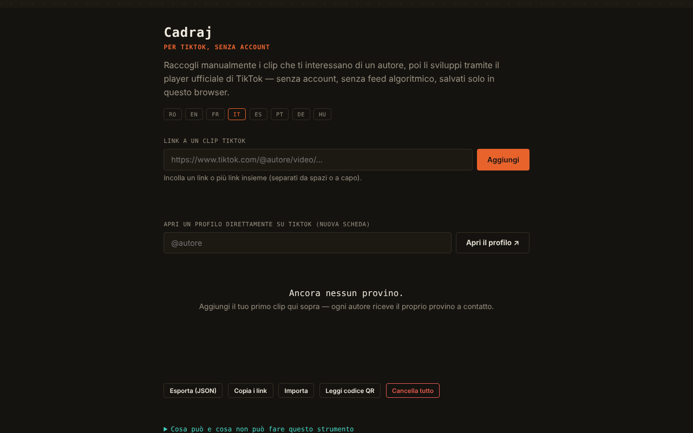

# Cadraj

[English](README.md) · [Română](README.ro.md) · [Français](README.fr.md) · **Italiano** · [Español](README.es.md) · [Português](README.pt.md) · [Deutsch](README.de.md) · [Magyar](README.hu.md)

**Versione:** 1.2.2 · **Ultimo aggiornamento:** 2026-10-22

Lingue dell'interfaccia: **Română, English, Français, Italiano, Español, Português (PT), Deutsch, Magyar**

Cadraj — per TikTok, senza account: un «provino a contatto» personale per clip TikTok aggiunte manualmente.

**Applicazione online:** https://chiuta.github.io/Cadraj/

## Che cos'è

Cadraj è un'applicazione in un unico file HTML in cui aggiungi manualmente link a clip TikTok di un autore; l'applicazione le raggruppa in raccolte (una per autore) e le mostra tramite il player di incorporamento ufficiale di TikTok, senza account e senza feed algoritmico. L'applicazione dice esplicitamente ciò che non fa: non elenca automaticamente le clip di un profilo, non aggira le protezioni di TikTok e non scarica file video.

## Funzioni

- Aggiunta di una clip tramite link (`https://www.tiktok.com/@autore/video/...`), con messaggio di stato; puoi incollare più link insieme (separati da spazio, virgola o a capo) — il riepilogo dice quanti sono stati aggiunti, quanti erano già nella raccolta e quanti sono stati ignorati.
- «Copia i link»: tutti i link della raccolta, uno per riga, negli appunti.
- Stile di stampa: si stampa solo l'elenco delle raccolte.
- Raccolte per autore, con una nota di testo per ogni clip.
- Apertura di un profilo TikTok in una nuova scheda (campo «@autore», pulsante «Apri il profilo ↗»); offline compare un messaggio esplicativo al posto della pagina di errore del browser.
- Ricerca nelle raccolte (per autore o parole nelle note) e filtro «Solo i fotogrammi non visti».
- Segno «visto» su ogni fotogramma (pulsante ○/✓; si spunta automaticamente quando apri il fotogramma nel player), con un contatore «N visti» sul provino; si conserva nella raccolta e nell'esportazione JSON.
- Vista ingrandita (lightbox) con navigazione ‹ / ›, tasti Freccia sinistra / Freccia destra ed Esc per chiudere.
- Esportazione e importazione della raccolta come file JSON; «Elimina tutto».
- Interfaccia in 8 lingue: RO, EN, FR, IT, ES, PT, DE, HU.

## Nuove funzioni (v1.1.0)

- **Codice QR per una raccolta**: contiene solo il nome utente e gli id dei fotogrammi (le foto contrassegnate con `p`), non le note né altre raccolte. Al massimo 40 clip in un codice, con il messaggio «40 di N». La lettura da un'immagine QR ricrea la raccolta; una seconda lettura non duplica, un QR estraneo e i nomi utente non validi (ad es. `__proto__`) vengono rifiutati, gli id non validi ignorati.
- **Modalità di accessibilità**: testo più grande (+25%), contrasto elevato, senza animazioni; le preferenze vengono conservate e incluse nella copia `.fff.json`.
- **Player con focus intrappolato**: all'apertura lo sfondo diventa inattivo (`inert`), Tab/Maiusc+Tab non escono dal player, Home/Fine/frecce navigano, Esc chiude e il focus torna sul fotogramma da cui è stato aperto.
- **Kit**: Trasparenza e copia `.fff.json` (le raccolte), `core, label, bundle, qr`.
- **Lingue e traduzioni**: i nuovi testi sono nelle 8 lingue dell'applicazione (RO, EN, FR, IT, ES, PT, DE, HU). Le traduzioni FR/IT/ES/PT/DE/HU sono automatiche e **non verificate da madrelingua**; la finestra del kit ha 8 lingue.

## Guida all'uso

1. Scegli la lingua dai pulsanti RO / EN / FR / IT / ES / PT / DE / HU.
2. Se vuoi trovare clip, scrivi «@autore» nel campo del profilo e premi «Apri il profilo ↗»; il profilo si apre su TikTok, in una scheda separata.
3. Copia il link di una clip, incollalo nel campo «Link a una clip TikTok» e premi «Aggiungi».
4. La clip compare nella raccolta dell'autore; puoi scrivere una nota sotto di essa (Invio conferma).
5. Premi su una clip per aprirla nel player; navighi con ‹ › o con le frecce della tastiera, chiudi con ✕ o Esc.
6. Usa «Cerca nelle raccolte» per filtrare.
7. «Esporta (JSON)» salva la raccolta in un file; «Importa» la ricarica; «Elimina tutto» svuota la raccolta.

## Privacy e rete

- Il kit «senza frontiere» (`fff-kit`, moduli `core, label, bundle, qr`) è incollato in `index.html`: non effettua richieste di rete. La finestra «Trasparenza» (clic sulla versione) mostra la rete dichiarata (0 richieste esterne), le chiavi di `localStorage`, lo SHA-256 del file e offre una copia di sicurezza `.fff.json` (facoltativamente cifrata con password, AES-GCM). I codici QR vengono generati e letti in locale; la lettura avviene solo da un'immagine scelta dall'utente, senza fotocamera.

- Locale: la raccolta (link e note) è conservata nel `localStorage` del browser, con la chiave `tiktok-fara-cont:v1`. Non ci sono account né un server proprio dell'applicazione; nel codice verificato non ci sono chiamate `fetch`.
- Rete: l'applicazione non è completamente offline (senza rete, la visualizzazione mostra un messaggio esplicativo). Alla visualizzazione di una clip viene caricato, in un iframe con `sandbox`, il player ufficiale `https://www.tiktok.com/player/v1/<id>`, quindi TikTok riceve la richiesta (e può applicare propri cookie/policy). Il pulsante del profilo e i link alle clip aprono `www.tiktok.com`. Nel codice non ci sono altri host di terze parti.
- Il piè di pagina dell'applicazione ora dice esplicitamente: «senza account · senza telemetria · senza server proprio · la riproduzione di una clip carica il player TikTok» (l'affermazione «senza telemetria» riguarda l'applicazione stessa, non il player TikTok nell'iframe).
- Marchi: TikTok è un marchio del suo titolare, usato a scopo descrittivo (l'applicazione non è affiliata a TikTok).

## Esecuzione locale / offline

Scarica `index.html` e aprilo in un browser. La raccolta e l'interfaccia funzionano in locale; la riproduzione delle clip e l'apertura dei profili richiedono internet.

## Licenza

MIT per il codice e la struttura dell'applicazione — vedi il file `LICENSE`. Eventuali librerie di terze parti incluse nel file mantengono le proprie licenze.

## Cronologia / Changelog

- 1.2.1 — 2026-10-22: **correzione**: interfaccia in ungherese completata (stringhe del codice QR e pannello di accessibilità, compreso il suggerimento sui tasti del player).
- 1.1.0 — 2026-10-14: codice QR per le raccolte, modalità di accessibilità, player con focus intrappolato, kit «senza frontiere». Test: `tests/fff-r8.test.mjs`.

### 1.2.2 — 2026-10-22
- Le finestre bloccanti alert()/confirm() sono state sostituite: gli errori di importazione appaiono nella riga di stato della pagina e le conferme di eliminazione usano una finestra accessibile e tradotta.
- Aree tattili più grandi (selettore della lingua e pulsanti piccoli di almeno 32–36 px).
- Mobile: nessun testo sotto i 12 px e aree tattili di almeno 24 px (WCAG 2.5.8).

### 1.0.0 — 2026-10-12
- La versione e la data dell'ultimo aggiornamento sono mostrate nell'applicazione (piè di pagina, in 7 lingue).

### 11 ottobre 2026 (round 7)
- Corretto: l'apertura di un profilo offline ora mostra un messaggio nell'applicazione (7 lingue), non la pagina di errore del browser.
- Novità: segno «visto» per fotogramma, contatore sul provino e filtro «Solo i fotogrammi non visti» (nuova chiave `seen` nella raccolta salvata/esportata).

### 11 ottobre 2026 (round 6)
- Aggiunto: aggiunta di link in blocco, pulsante «Copia i link», stile di stampa, nuovi messaggi in 7 lingue.
- Sicurezza: CSP con `script-src` tramite hash (senza `'unsafe-inline'` per gli script).

### 11 ottobre 2026
- Aggiunto: attributo `sandbox` sull'iframe del player TikTok e policy CSP (frame-src solo `www.tiktok.com`, senza connect-src).
- Aggiunto: messaggio chiaro nella visualizzazione quando il browser è offline (invece di un riquadro vuoto), in tutte e 7 le lingue.
- Corretto: il contenuto della pagina è ora racchiuso in `<main>` (0 violazioni axe-core a 1280 e 360 px).

## Autore

Alexio — Alexandru-Ionuț Chiuță, contatto: alexio@trom.tf

## Sintesi

Cadraj è uno strumento HTML a file singolo per costruire un provino a contatto personale di clip TikTok aggiunte manualmente tramite link, raggruppate per autore, riprodotte tramite il player di incorporamento ufficiale di TikTok, con note, ricerca, lightbox, incollaggio di link in blocco, copia di tutti i link ed esportazione/importazione JSON. I dati restano in localStorage; la riproduzione carica tiktok.com in un iframe, quindi serve internet. Interfaccia in 8 lingue. Non estrae dati dai profili e non scarica video.

## Audit

Audit: 2026-10-10 — verificato: 0 errori JS, 0 problemi axe gravi/critici; l'unico traffico esterno è l'iframe del player ufficiale `tiktok.com/player/v1/<id>` (l'ID passa per una validazione `\d{5,25}`, l'importazione JSON è sanificata, i testi sono inseriti con `textContent`). Il piè di pagina «senza account · senza telemetria · senza server» si riferisce all'applicazione; alla riproduzione di una clip TikTok, TikTok riceve l'indirizzo IP e l'ID della clip (l'applicazione lo dice nel pannello «Info»). L'applicazione non è affiliata a TikTok; il rispetto dei termini di TikTok per gli incorporamenti resta a carico dell'utente.
