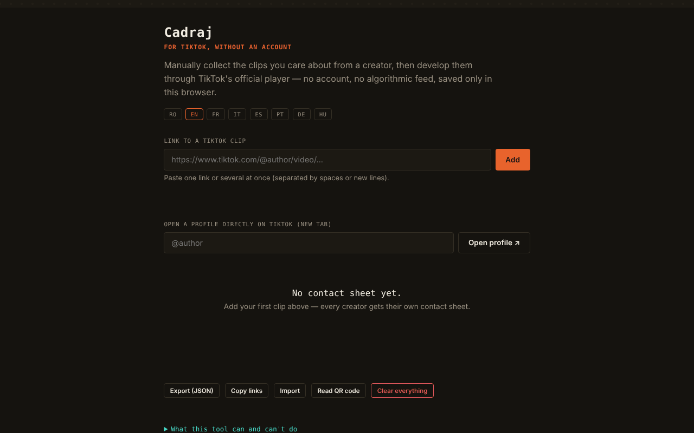

# Cadraj

**English** · [Română](README.ro.md) · [Français](README.fr.md) · [Italiano](README.it.md) · [Español](README.es.md) · [Português](README.pt.md) · [Deutsch](README.de.md) · [Magyar](README.hu.md)

**Version:** 1.2.2 · **Last updated:** 2026-10-22

Interface languages: **Română, English, Français, Italiano, Español, Português (PT), Deutsch, Magyar**

Cadraj — for TikTok, without an account: a personal "contact sheet" for TikTok clips added manually.

**Live:** https://chiuta.github.io/Cadraj/

## What it is

Cadraj is a single-HTML-file app in which you manually add links to an author's TikTok clips, and the app groups them into collections (one per author) and displays them through TikTok's official embed player, with no account and no algorithmic feed. The app states explicitly what it does not do: it does not automatically list a profile's clips, it does not bypass TikTok's protections and it does not download video files.

## Features

- Adding a clip by link (`https://www.tiktok.com/@author/video/...`), with a status message; you can paste several links at once (separated by space, comma or new line) — the summary says how many were added, how many were already in the collection and how many were ignored.
- "Copy links": all the links in the collection, one per line, to the clipboard.
- Print style: only the list of collections is printed.
- Collections per author, with a text note for each clip.
- Opening a TikTok profile in a new tab ("@author" field, "Open profile ↗" button); offline, an explanatory message appears instead of the browser's error page.
- Search in collections (by author or words in notes) and the "Unseen frames only" filter.
- "Seen" mark on each frame (○/✓ button; ticked automatically when you open the frame in the player), with an "N seen" counter on the sheet; it is kept in the collection and in the JSON export.
- Enlarged view (lightbox) with ‹ / › navigation, Left arrow / Right arrow keys and Escape to close.
- Export and import of the collection as a JSON file; "Delete all".
- Interface in 8 languages: RO, EN, FR, IT, ES, PT, DE, HU.

## New features (v1.1.0)

- **QR code for a collection**: it contains only the username and the frame ids (photos marked with `p`), not the notes and not other collections. At most 40 clips in one code, with the message "40 of N". Reading from a QR image recreates the collection; a second read does not duplicate, a foreign QR and invalid usernames (e.g. `__proto__`) are rejected, invalid ids ignored.
- **Accessibility mode**: larger text (+25%), high contrast, no animations; the preferences are kept and included in the `.fff.json` copy.
- **Player with trapped focus**: on opening, the background becomes inactive (`inert`), Tab/Shift+Tab do not leave the player, Home/End/arrows navigate, Esc closes and focus returns to the frame it was opened from.
- **Kit**: Transparency and `.fff.json` copy (the collections), `core, label, bundle, qr`.
- **Languages and translations**: The new texts are in the app's 8 languages (RO, EN, FR, IT, ES, PT, DE, HU). The FR/IT/ES/PT/DE/HU translations are automatic and **not verified by native speakers**; the kit dialog has 8 languages.

## User guide

1. Choose the language from the RO / EN / FR / IT / ES / PT / DE / HU buttons.
2. If you want to find clips, type "@author" in the profile field and press "Open profile ↗"; the profile opens on TikTok, in a separate tab.
3. Copy a clip's link, paste it into the "Link to a TikTok clip" field and press "Add".
4. The clip appears in the author's collection; you can write a note under it (Enter confirms).
5. Click a clip to open it in the player; you navigate with ‹ › or with the keyboard arrows, and close with ✕ or Escape.
6. Use "Search in collections" to filter.
7. "Export (JSON)" saves the collection to a file; "Import" loads it back; "Delete all" empties the collection.

## Privacy and network

- The "without borders" kit (`fff-kit`, modules `core, label, bundle, qr`) is pasted into `index.html`: it makes no network requests. The "Transparency" dialog (click on the version) shows the declared network (0 external requests), the `localStorage` keys, the SHA-256 of the file and offers a `.fff.json` backup copy (optionally encrypted with a password, AES-GCM). QR codes are generated and read locally; reading is done only from an image chosen by the user, without the camera.

- Local: the collection (links and notes) is kept in the browser's `localStorage`, under the key `tiktok-fara-cont:v1`. There is no account and no server of the app's own; in the audited code there are no `fetch` calls.
- Network: the app is not fully offline (without a network, the view shows an explanatory message). When a clip is viewed, the official player `https://www.tiktok.com/player/v1/<id>` is loaded in a `sandbox`ed iframe, so TikTok receives the request (and may apply its own cookies/policies). The profile button and the links to clips open `www.tiktok.com`. There are no other third-party hosts in the code.
- The app's footer now states explicitly: "no account · no telemetry · no server of its own · playing a clip loads the TikTok player" (the claim "no telemetry" concerns the app itself, not the TikTok player in the iframe).
- Trademarks: TikTok is a trademark of its owner, used descriptively (the app is not affiliated with TikTok).

## Running locally / offline

Download `index.html` and open it in a browser. The collection and the interface work locally; playing clips and opening profiles require internet.

## License

MIT for the app's code and structure — see the `LICENSE` file. Any third-party libraries included in the file keep their own licenses.

## History / Changelog

- 1.2.1 — 2026-10-22: **fix**: Hungarian interface completed (QR code strings and accessibility panel, including the player-keys hint).
- 1.1.0 — 2026-10-14: QR code for collections, accessibility mode, player with trapped focus, "without borders" kit. Tests: `tests/fff-r8.test.mjs`.

### 1.2.2 — 2026-10-22
- The blocking alert()/confirm() boxes were replaced: import errors appear in the page's status line, and the delete/clear confirmations use a translated accessible dialog.
- Larger touch targets (language switcher and small buttons at least 32–36 px).
- Mobile: no text below 12 px and touch targets of at least 24 px (WCAG 2.5.8).

### 1.0.0 — 2026-10-12
- The version and the date of the last update are displayed in the app (footer, in 7 languages).

### 11 October 2026 (round 7)
- Fixed: opening a profile offline now displays a message in the app (7 languages), not the browser's error page.
- New: "seen" mark per frame, counter on the sheet and the "Unseen frames only" filter (new key `seen` in the saved/exported collection).

### 11 October 2026 (round 6)
- Added: bulk link adding, the "Copy links" button, print style, new messages in 7 languages.
- Security: CSP with `script-src` by hash (no `'unsafe-inline'` for script).

### 11 October 2026
- Added: `sandbox` attribute on the TikTok player iframe and CSP policy (frame-src only `www.tiktok.com`, no connect-src).
- Added: clear message in the view when the browser is offline (instead of an empty frame), in all 7 languages.
- Fixed: the page content is now wrapped in `<main>` (0 axe-core violations at 1280 and 360 px).

## Author

Alexio — Alexandru-Ionuț Chiuță, contact: alexio@trom.tf

## Summary

Cadraj is a single-file HTML tool for building a personal contact sheet of TikTok clips you add manually by link, grouped per author, played through TikTok's official embed player, with notes, search, lightbox, bulk link paste, copy-all-links, and JSON export/import. Data stays in localStorage; playback loads tiktok.com in an iframe, so it needs internet. 8 UI languages. It does not scrape profiles or download videos.

## Audit

Audit: 2026-10-10 — verified: 0 JS errors, 0 serious/critical axe issues; the only external traffic is the official player iframe `tiktok.com/player/v1/<id>` (the ID goes through `\d{5,25}` validation, the JSON import is sanitized, texts are inserted with `textContent`). The footer "no account · no telemetry · no server" refers to the app; when a TikTok clip is played, TikTok receives the IP address and the clip ID (the app says so in the "Info" panel). The app is not affiliated with TikTok; compliance with TikTok's terms for embeds remains the user's responsibility.
