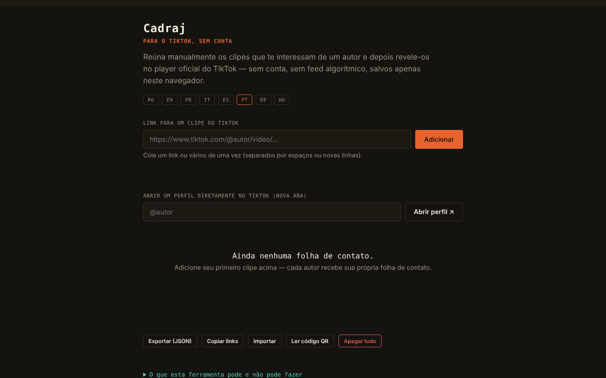

# Cadraj

[English](README.md) · [Română](README.ro.md) · [Français](README.fr.md) · [Italiano](README.it.md) · [Español](README.es.md) · **Português** · [Deutsch](README.de.md) · [Magyar](README.hu.md)

**Versão:** 2.2.0 · **Última atualização:** 2026-10-27

Idiomas da interface: **Română, English, Français, Italiano, Español, Português (PT), Deutsch, Magyar**

Cadraj — para o TikTok, sem conta: uma «folha de contactos» pessoal para clipes do TikTok adicionados manualmente.

**Aplicação online:** https://chiuta.github.io/Cadraj/

## O que é

O Cadraj é uma aplicação num único ficheiro HTML em que se adicionam manualmente ligações para clipes do TikTok de um autor; a aplicação agrupa-os em coleções (uma por autor) e apresenta-os através do leitor de incorporação oficial do TikTok, sem conta e sem feed algorítmico. A aplicação diz explicitamente o que não faz: não enumera automaticamente os clipes de um perfil, não contorna as proteções do TikTok e não descarrega ficheiros de vídeo.

## Funcionalidades

- Adicionar um clipe por ligação (`https://www.tiktok.com/@autor/video/...`), com mensagem de estado; pode colar várias ligações de uma só vez (separadas por espaço, vírgula ou mudança de linha) — o resumo diz quantas foram adicionadas, quantas já estavam na coleção e quantas foram ignoradas.
- «Copiar as ligações»: todas as ligações da coleção, uma por linha, para a área de transferência.
- Estilo de impressão: imprime-se apenas a lista de coleções.
- Coleções por autor, com uma nota de texto para cada clipe.
- Abertura de um perfil do TikTok num novo separador (campo «@autor», botão «Abrir o perfil ↗»); offline aparece uma mensagem explicativa em vez da página de erro do navegador.
- Pesquisa nas coleções (por autor ou por palavras das notas) e filtro «Apenas os fotogramas não vistos».
- Marca «visto» em cada fotograma (botão ○/✓; assinala-se automaticamente quando abre o fotograma no leitor), com um contador «N vistos» na folha; é guardada na coleção e na exportação JSON.
- Vista ampliada (lightbox) com navegação ‹ / ›, teclas Seta esquerda / Seta direita e Escape para fechar.
- Exportação e importação da coleção como ficheiro JSON; «Apagar tudo».
- Interface em 8 línguas: RO, EN, FR, IT, ES, PT, DE, HU.

## Novas funcionalidades (v1.1.0)

- **Código QR para uma coleção**: contém apenas o nome de utilizador e os ids dos fotogramas (as fotografias assinaladas com `p`), não as notas nem outras coleções. No máximo 40 clipes num código, com a mensagem «40 de N». A leitura a partir de uma imagem QR recria a coleção; uma segunda leitura não duplica, um QR estranho e os nomes de utilizador inválidos (por ex. `__proto__`) são rejeitados, os ids inválidos ignorados.
- **Modo de acessibilidade**: texto maior (+25 %), contraste elevado, sem animações; as preferências são guardadas e entram na cópia `.fff.json`.
- **Leitor com foco preso**: ao abrir, o fundo fica inativo (`inert`), Tab/Shift+Tab não saem do leitor, Home/End/setas navegam, Esc fecha e o foco regressa ao fotograma de onde foi aberto.
- **Kit**: Transparência e cópia `.fff.json` (as coleções), `core, label, bundle, qr`.
- **Línguas e traduções**: os textos novos estão nas 8 línguas da aplicação (RO, EN, FR, IT, ES, PT, DE, HU). As traduções FR/IT/ES/PT/DE/HU são automáticas e **não foram verificadas por falantes nativos**; a caixa de diálogo do kit tem 8 línguas.

## Manual de utilização

1. Escolha a língua nos botões RO / EN / FR / IT / ES / PT / DE / HU.
2. Se quiser encontrar clipes, escreva «@autor» no campo de perfil e prima «Abrir o perfil ↗»; o perfil abre no TikTok, num separador à parte.
3. Copie a ligação de um clipe, cole-a no campo «Ligação para um clipe do TikTok» e prima «Adicionar».
4. O clipe aparece na coleção do autor; pode escrever uma nota por baixo (Enter confirma).
5. Clique num clipe para o abrir no leitor; navega com ‹ › ou com as setas do teclado e fecha com ✕ ou Escape.
6. Use «Pesquisar nas coleções» para filtrar.
7. «Exportar (JSON)» guarda a coleção num ficheiro; «Importar» volta a carregá-la; «Apagar tudo» esvazia a coleção.

## Privacidade e rede

- O kit «sem fronteiras» (`fff-kit`, módulos `core, label, bundle, qr`) está colado em `index.html`: não faz pedidos de rede. A caixa «Transparência» (clique na versão) mostra a rede declarada (0 pedidos externos), as chaves de `localStorage`, o SHA-256 do ficheiro e oferece uma cópia de segurança `.fff.json` (opcionalmente cifrada com palavra-passe, AES-GCM). Os códigos QR são gerados e lidos localmente; a leitura faz-se apenas a partir de uma imagem escolhida pelo utilizador, sem câmara.

- Local: a coleção (ligações e notas) é guardada no `localStorage` do navegador, sob a chave `cadraj.collection`. Não há conta nem servidor próprio da aplicação; no código verificado não há chamadas `fetch`.
- Rede: a aplicação não é totalmente offline (sem rede, a vista mostra uma mensagem explicativa). Ao ver um clipe, é carregado, num iframe com `sandbox`, o leitor oficial `https://www.tiktok.com/player/v1/<id>`, pelo que o TikTok recebe o pedido (e pode aplicar os seus próprios cookies/políticas). O botão de perfil e as ligações para clipes abrem `www.tiktok.com`. Não há outros anfitriões de terceiros no código.
- O rodapé da aplicação diz agora explicitamente: «sem conta · sem telemetria · sem servidor próprio · a reprodução de um clipe carrega o leitor do TikTok» (a afirmação «sem telemetria» diz respeito à própria aplicação, não ao leitor do TikTok no iframe).
- Marcas: o TikTok é uma marca do seu titular, usada de forma descritiva (a aplicação não é afiliada ao TikTok).

## Execução local / offline

Descarregue `index.html` e abra-o num navegador. A coleção e a interface funcionam localmente; a reprodução de clipes e a abertura de perfis requerem internet.

## Licença

MIT para o código e a estrutura da aplicação — ver o ficheiro `LICENSE`. Eventuais bibliotecas de terceiros incluídas no ficheiro mantêm as suas próprias licenças.

## Histórico / Changelog

- 1.2.6 — 2026-10-23: As chaves de armazenamento têm agora o prefixo da aplicação (`cadraj.collection`); os dados existentes (coleção guardada) são migrados automaticamente no arranque e as cópias antigas `.fff.json` continuam a poder ser importadas. fff-kit 1.2.0: armazenamento sem prefixo corrigido
- 1.2.4 — 2026-10-22: fff-kit 1.1.4: alvos de toque e tamanho mínimo do texto
- 1.2.3 — 2026-10-22: fff-kit 1.1.2: PBKDF2 600 000 iterações, proteção anti-clickjacking
- 1.2.1 — 2026-10-22: **correção**: interface em húngaro completada (cadeias do código QR e painel de acessibilidade, incluindo a dica das teclas do leitor).
- 1.1.0 — 2026-10-14: código QR para coleções, modo de acessibilidade, leitor com foco preso, kit «sem fronteiras». Testes: `tests/fff-r8.test.mjs`.

### 1.2.2 — 2026-10-22
- As caixas bloqueantes alert()/confirm() foram substituídas: os erros de importação surgem na linha de estado da página e as confirmações de eliminação usam um diálogo acessível e traduzido.
- Áreas táteis maiores (seletor de idioma e botões pequenos com pelo menos 32–36 px).
- Telemóvel: nenhum texto abaixo de 12 px e áreas táteis de pelo menos 24 px (WCAG 2.5.8).

### 1.0.0 — 2026-10-12
- A versão e a data da última atualização são apresentadas na aplicação (rodapé, em 7 línguas).

### 11 de outubro de 2026 (ronda 7)
- Corrigido: a abertura de um perfil offline mostra agora uma mensagem na aplicação (7 línguas), e não a página de erro do navegador.
- Novo: marca «visto» por fotograma, contador na folha e filtro «Apenas os fotogramas não vistos» (nova chave `seen` na coleção guardada/exportada).

### 11 de outubro de 2026 (ronda 6)
- Acrescentado: adição em massa de ligações, botão «Copiar as ligações», estilo de impressão, novas mensagens em 7 línguas.
- Segurança: CSP com `script-src` por hash (sem `'unsafe-inline'` para scripts).

### 11 de outubro de 2026
- Acrescentado: atributo `sandbox` no iframe do leitor do TikTok e política CSP (frame-src apenas `www.tiktok.com`, sem connect-src).
- Acrescentado: mensagem clara na vista quando o navegador está offline (em vez de uma moldura vazia), nas 7 línguas.
- Corrigido: o conteúdo da página está agora envolvido em `<main>` (0 violações axe-core a 1280 e 360 px).

## Autor

Alexio — Alexandru-Ionuț Chiuță, contacto: alexio@trom.tf

## Resumo

O Cadraj é uma ferramenta HTML de ficheiro único para construir uma folha de contactos pessoal de clipes do TikTok adicionados manualmente por ligação, agrupados por autor, reproduzidos através do leitor de incorporação oficial do TikTok, com notas, pesquisa, lightbox, colagem em massa de ligações, cópia de todas as ligações e exportação/importação JSON. Os dados ficam em localStorage; a reprodução carrega tiktok.com num iframe, pelo que precisa de internet. Interface em 8 línguas. Não extrai dados dos perfis nem descarrega vídeos.

## Auditoria

Auditoria: 2026-10-10 — verificado: 0 erros JS, 0 problemas axe graves/críticos; o único tráfego externo é o iframe do leitor oficial `tiktok.com/player/v1/<id>` (o ID passa por uma validação `\d{5,25}`, a importação JSON é sanitizada, os textos são inseridos com `textContent`). O rodapé «sem conta · sem telemetria · sem servidor» refere-se à aplicação; ao reproduzir um clipe do TikTok, o TikTok recebe o endereço IP e o ID do clipe (a aplicação di-lo no painel «Info»). A aplicação não é afiliada ao TikTok; o cumprimento dos termos do TikTok para as incorporações continua a cargo do utilizador.
