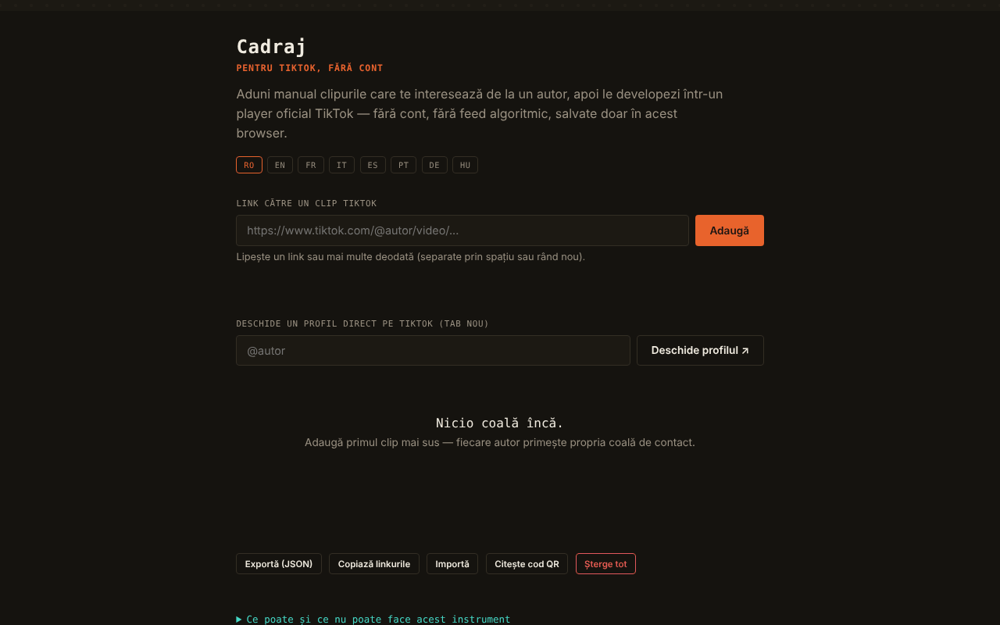

# Cadraj

[English](README.md) · **Română** · [Français](README.fr.md) · [Italiano](README.it.md) · [Español](README.es.md) · [Português](README.pt.md) · [Deutsch](README.de.md) · [Magyar](README.hu.md)

**Versiune:** 2.0.0 · **Ultima actualizare:** 2026-10-26

Limbile interfeței: **Română, English, Français, Italiano, Español, Português (PT), Deutsch, Magyar**

Cadraj — pentru TikTok, fără cont: o „coală de contact" personală pentru clipuri TikTok adăugate manual.

**Live:** https://chiuta.github.io/Cadraj/

## Ce este

Cadraj este o aplicație dintr-un singur fișier HTML în care adaugi manual linkuri către clipuri TikTok ale unui autor, iar aplicația le grupează pe colecții (câte una pe autor) și le afișează prin playerul oficial de embed TikTok, fără cont și fără feed algoritmic. Aplicația spune explicit ce nu face: nu enumeră automat clipurile unui profil, nu ocolește protecțiile TikTok și nu descarcă fișiere video.

## Funcții

- Adăugare clip după link (`https://www.tiktok.com/@autor/video/...`), cu mesaj de stare; poți lipi mai multe linkuri deodată (separate prin spațiu, virgulă sau rând nou) — rezumatul spune câte au fost adăugate, câte erau deja în colecție și câte au fost ignorate.
- „Copiază linkurile”: toate linkurile din colecție, câte unul pe rând, în clipboard.
- Stil de tipărire: se tipărește doar lista de colecții.
- Colecții pe autor, cu notiță text pentru fiecare clip.
- Deschiderea unui profil TikTok într-un tab nou (câmpul „@autor", butonul „Deschide profilul ↗"); offline apare un mesaj explicativ în loc de pagina de eroare a browserului.
- Căutare în colecții (după autor sau cuvinte din notițe) și filtrul „Doar cadrele nevăzute”.
- Marcaj „văzut” pe fiecare cadru (buton ○/✓; se bifează automat când deschizi cadrul în player), cu numărătoare „N văzute” pe coală; se păstrează în colecție și în exportul JSON.
- Vizualizare mărită (lightbox) cu navigare ‹ / ›, tastele Săgeată stânga / Săgeată dreapta și Escape pentru închidere.
- Export și import al colecției ca fișier JSON; „Șterge tot".
- Interfață în 8 limbi: RO, EN, FR, IT, ES, PT, DE, HU.
- **Caiete de monitorizare (2.0.0):** colecții tematice de clipuri cu fișă de analiză (autor, dată indicată, dată calculată din ID, sursă, rezumat), listă de verificare (căutare inversă, context, dată) și citate legate de secunda din clip; export/copiere Markdown cu frontmatter. În player, „citat rapid” (secunda scrisă manual; „secunda curentă” și „sari la secundă” folosesc mesajele playerului TikTok, în regim best-effort, netestate cu playerul real). Același clip nu poate apărea în două colecții (cheie = ID).

## Funcții noi (v1.1.0)

- **Cod QR pentru o colecție**: conține doar numele de utilizator și id-urile cadrelor (fotografiile marcate cu `p`), nu notele și nu alte colecții. Maximum 40 de clipuri într-un cod, cu mesaj „40 din N”. Citirea dintr-o imagine QR recreează colecția; a doua citire nu duplică, QR-ul străin și numele de utilizator invalide (de ex. `__proto__`) sunt respinse, id-urile invalide ignorate.
- **Mod de accesibilitate**: text mai mare (+25%), contrast ridicat, fără animații; preferințele se păstrează și intră în copia `.fff.json`.
- **Player cu focus prins**: la deschidere fundalul devine inactiv (`inert`), Tab/Shift+Tab nu ies din player, Home/End/săgeți navighează, Esc închide și focusul revine pe cadrul de unde s-a deschis.
- **Kit**: Transparență și copie `.fff.json` (colecțiile), `core, label, bundle, qr`.
- **Limbi și traduceri**: Textele noi sunt în cele 8 limbi ale aplicației (RO, EN, FR, IT, ES, PT, DE, HU). Traducerile FR/IT/ES/PT/DE/HU sunt automate și **neverificate de vorbitori nativi**; dialogul kitului are 8 limbi.

## Manual de utilizare

1. Alege limba din butoanele RO / EN / FR / IT / ES / PT / DE / HU.
2. Dacă vrei să găsești clipuri, scrie „@autor" în câmpul de profil și apasă „Deschide profilul ↗"; profilul se deschide pe TikTok, într-un tab separat.
3. Copiază linkul unui clip, lipește-l în câmpul „Link către un clip TikTok" și apasă „Adaugă".
4. Clipul apare în colecția autorului; poți scrie o notiță sub el (Enter confirmă).
5. Apasă pe un clip pentru a-l deschide în player; navighezi cu ‹ › sau cu săgețile de la tastatură, închizi cu ✕ sau Escape.
6. Folosește „Caută în colecții" pentru a filtra.
7. „Exportă (JSON)" salvează colecția într-un fișier; „Importă" o încarcă înapoi; „Șterge tot" golește colecția.

## Confidențialitate și rețea

- Kitul „fără frontiere” (`fff-kit`, modulele `core, label, bundle, qr`) este lipit în `index.html`: nu face cereri de rețea. Dialogul „Transparență” (clic pe versiune) arată rețeaua declarată (0 cereri externe), cheile din `localStorage`, SHA-256 al fișierului și oferă copie de siguranță `.fff.json` (opțional criptată cu parolă, AES-GCM). Codurile QR se generează și se citesc local; citirea se face doar dintr-o imagine aleasă de utilizator, fără cameră.

- Local: colecția (linkurile și notițele) se păstrează în `localStorage` al browserului, sub cheia `cadraj.collection`. Nu există cont și nici server propriu al aplicației; în codul verificat nu există apeluri `fetch`.
- Rețea: aplicația nu este complet offline (fără rețea, vizualizarea afișează un mesaj explicativ). La vizualizarea unui clip se încarcă, într-un iframe cu `sandbox`, playerul oficial `https://www.tiktok.com/player/v1/<id>`, deci TikTok primește cererea (și poate aplica propriile cookie-uri/politici). Butonul de profil și linkurile către clipuri deschid `www.tiktok.com`. Nu sunt alte gazde terțe în cod.
- Subsolul aplicației spune acum explicit: „fără cont · fără telemetrie · fără server propriu · redarea unui clip încarcă playerul TikTok” (afirmația „fără telemetrie” privește aplicația în sine, nu playerul TikTok din iframe).
- Mărci: TikTok este marcă a deținătorului ei, folosită descriptiv (aplicația nu este afiliată TikTok).

## Rulare locală / offline

Descarcă `index.html` și deschide-l în browser. Colecția și interfața funcționează local; redarea clipurilor și deschiderea profilurilor necesită internet.

## Licență

MIT pentru codul și structura aplicației — vezi fișierul `LICENSE`. Eventualele biblioteci terțe incluse în fișier își păstrează licențele proprii.

## Istoric / Changelog

- 1.2.6 — 2026-10-23: Cheile de stocare au acum prefixul aplicației (`cadraj.collection`); datele existente (colecția salvată) se migrează automat la pornire, iar copiile vechi `.fff.json` se pot importa în continuare. fff-kit 1.2.0: stocare fără prefix remediată
- 1.2.4 — 2026-10-22: fff-kit 1.1.4: ținte tactile și text minim
- 1.2.3 — 2026-10-22: fff-kit 1.1.2: PBKDF2 600 000 iterații, protecție anti-clickjacking
- 1.2.1 — 2026-10-22: **remediere**: interfața în maghiară completată (șirurile pentru codul QR și panoul de accesibilitate, inclusiv indiciul pentru tastele playerului).
- 1.1.0 — 2026-10-14: cod QR pentru colecții, mod de accesibilitate, player cu focus prins, kit „fără frontiere”. Teste: `tests/fff-r8.test.mjs`.

### 1.2.2 — 2026-10-22
- Casetele blocante alert()/confirm() au fost înlocuite: erorile de import apar în linia de stare a paginii, iar confirmările de ștergere folosesc un dialog accesibil, tradus.
- Ținte tactile mai mari (selectorul de limbă și butoanele mici, minimum 32–36 px).
- Mobil: niciun text sub 12 px și ținte tactile de cel puțin 24 px (WCAG 2.5.8).

### 1.0.0 — 2026-10-12
- Versiunea și data ultimei actualizări sunt afișate în aplicație (subsol, în 7 limbi).

### 11 octombrie 2026 (runda 7)
- Reparat: deschiderea unui profil offline afișează acum un mesaj în aplicație (7 limbi), nu pagina de eroare a browserului.
- Nou: marcaj „văzut” per cadru, numărătoare pe coală și filtrul „Doar cadrele nevăzute” (cheie nouă `seen` în colecția salvată/exportată).

### 11 octombrie 2026 (runda 6)
- Adăugat: adăugare în masă de linkuri, butonul „Copiază linkurile”, stil de tipărire, mesaje noi în 7 limbi.
- Securitate: CSP cu `script-src` pe hash (fără `'unsafe-inline'` pentru script).

### 11 octombrie 2026
- Adăugat: atribut `sandbox` pe iframe-ul playerului TikTok și politică CSP (frame-src doar `www.tiktok.com`, fără connect-src).
- Adăugat: mesaj clar în vizualizare când browserul e offline (în loc de un cadru gol), în toate cele 7 limbi.
- Reparat: conținutul paginii este acum încadrat în `<main>` (0 violări axe-core la 1280 și 360 px).

## Autor

Alexio — Alexandru-Ionuț Chiuță, contact: alexio@trom.tf

## Rezumat

Cadraj este un instrument într-un singur fișier HTML pentru alcătuirea unui contact sheet personal de clipuri TikTok adăugate manual prin link, grupate pe autor, redate prin playerul oficial de încorporare TikTok, cu notițe, căutare, lightbox, lipire în masă de linkuri, copierea tuturor linkurilor și export/import JSON. Datele rămân în localStorage; redarea încarcă tiktok.com într-un iframe, deci necesită internet. 8 limbi de interfață. Nu extrage date din profiluri și nu descarcă videoclipuri.

## Audit

Audit: 2026-10-10 — verificat: 0 erori JS, 0 probleme axe serious/critical; singurul trafic extern este iframe-ul playerului oficial `tiktok.com/player/v1/<id>` (ID-ul trece prin validare `\d{5,25}`, importul JSON este sanitizat, textele sunt inserate cu `textContent`). Subsolul „fără cont · fără telemetrie · fără server” se referă la aplicație; la redarea unui clip TikTok primește adresa IP și ID-ul clipului (aplicația spune asta în panoul „Info”). Aplicația nu este afiliată TikTok; respectarea termenilor TikTok pentru embed-uri rămâne în sarcina utilizatorului.
